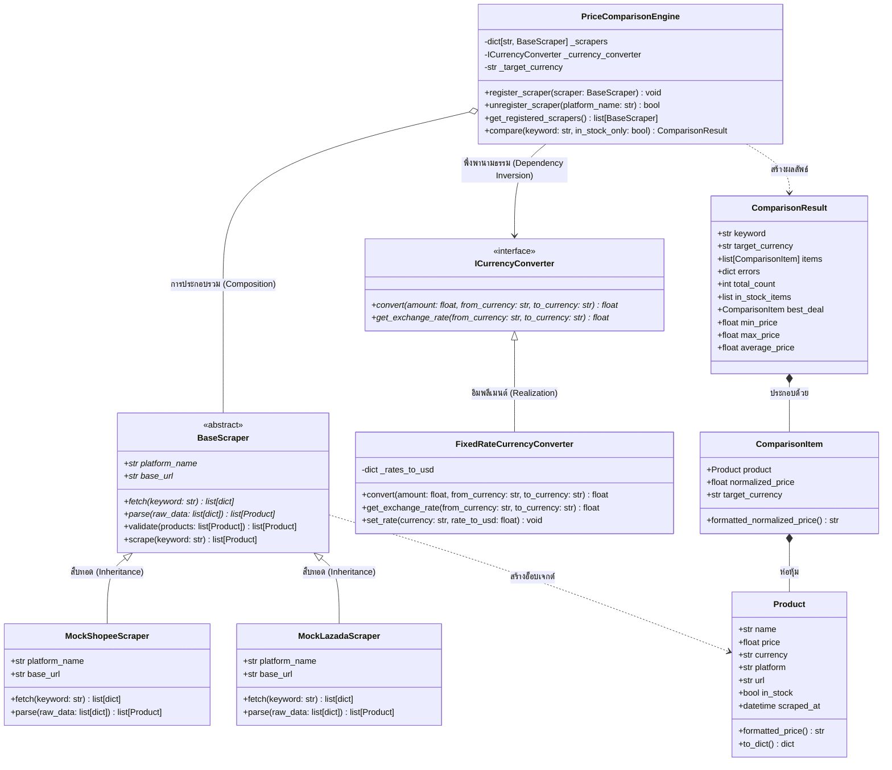
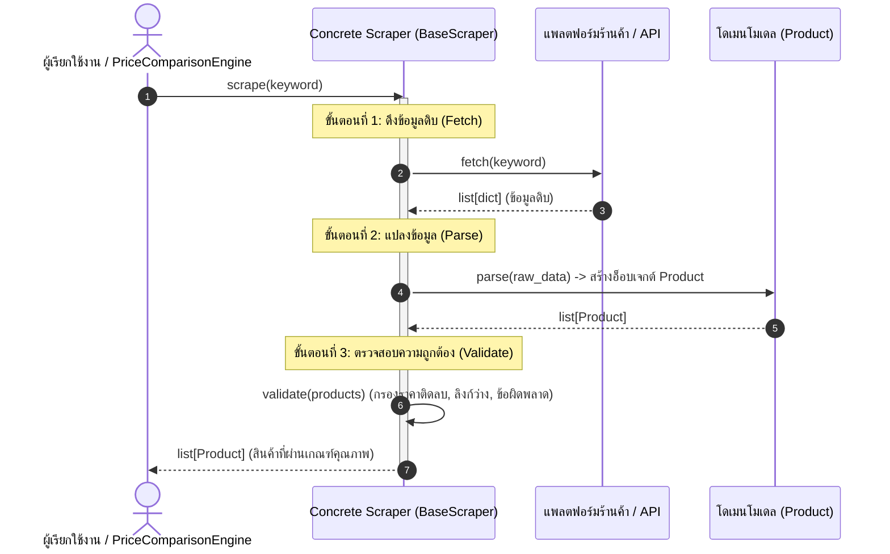

# PriceWise Tracker - ระบบเปรียบเทียบราคาสินค้าเชิงวัตถุ (OOP & OOAD)

ระบบเปรียบเทียบราคาสินค้าออนไลน์ที่พัฒนาขึ้นตามหลักการ **การวิเคราะห์และการออกแบบเชิงวัตถุ (Object-Oriented Analysis & Design: OOAD)** ในระดับมาตรฐานวิศวกรรมซอฟต์แวร์ โครงงานนี้สาธิตการประยุกต์ใช้ดีไซน์แพตเทิร์นพื้นฐาน (Design Patterns), การปฏิบัติตามหลักการ **SOLID** อย่างเคร่งครัด และการจัดวางโครงสร้างสถาปัตยกรรมแบบแยกส่วน (Clean Decoupled Architecture)

---

## 📑 สารบัญ (Table of Contents)
- [สถาปัตยกรรมและการออกแบบ (Architecture & Design)](#-สถาปัตยกรรมและการออกแบบ-architecture--design)
  - [แผนภาพคลาส (Class Diagram)](#แผนภาพคลาส-class-diagram)
  - [วงจรชีวิตของ Template Method (Template Method Lifecycle)](#วงจรชีวิตของ-template-method-template-method-lifecycle)
- [การปฏิบัติตามหลักการ SOLID (SOLID Principles Adherence)](#-การปฏิบัติตามหลักการ-solid-solid-principles-adherence)
- [รูปแบบการออกแบบที่นำมาใช้ (Design Patterns)](#-รูปแบบการออกแบบที่นำมาใช้-design-patterns)
- [โครงสร้างไดเรกทอรีของโครงงาน (Directory Structure)](#-โครงสร้างไดเรกทอรีของโครงงาน-directory-structure)
- [การติดตั้งและวิธีเริ่มต้นใช้งาน (Installation & Quickstart)](#-การติดตั้งและวิธีเริ่มต้นใช้งาน-installation--quickstart)
- [การทดสอบด้วย Unit Tests (Running Unit Tests)](#-การทดสอบด้วย-unit-tests-running-unit-tests)
- [การขยายระบบเพิ่มเติม (Extending the System)](#-การขยายระบบเพิ่มเติม-extending-the-system)

---

## 🏛 สถาปัตยกรรมและการออกแบบ (Architecture & Design)

ระบบจำลองแพลตฟอร์มการรวบรวมข้อมูลอีคอมเมิร์ซ (E-commerce Aggregation Platform) โดยมีตัวดึงข้อมูลจากแต่ละร้านค้า (Scrapers) ทำหน้าที่ดึงและแปลงข้อมูลที่มีโครงสร้างแตกต่างกัน, ตรวจสอบความถูกต้องของกฎสถาปัตยกรรม (Domain Invariants), ปรับมาตรฐานสกุลเงินข้ามพรมแดนให้เป็นสกุลเงินเดียวกัน และจัดเรียงลำดับราคาเพื่อค้นหาข้อเสนอที่ดีที่สุดสำหรับผู้บริโภค

### แผนภาพคลาส (Class Diagram)



---

### วงจรชีวิตของ Template Method (Template Method Lifecycle)

ระบบ Scraper ถูกควบคุมด้วยรูปแบบ **Template Method Pattern** ผ่านเมธอด `BaseScraper.scrape(keyword)` ซึ่งกำหนดโครงสร้างลำดับขั้นตอนการทำงานที่ตายตัวในคลาสฐาน (Invariant Workflow) ในขณะที่รายละเอียดการเชื่อมต่อ API และการแปลงโครงสร้างข้อมูลเฉพาะของแต่ละแพลตฟอร์มถูกส่งต่อไปให้คลาสลูกเป็นผู้อิมพลีเมนต์



---

## 🎯 การปฏิบัติตามหลักการ SOLID (SOLID Principles Adherence)

| หลักการ (Principle) | รายละเอียดการประยุกต์ใช้งานในระบบ |
|---|---|
| **Single Responsibility (SRP)<br>ความรับผิดชอบเดี่ยว** | - `Product`: รับผิดชอบเฉพาะการเก็บข้อมูลสินค้าและตรวจสอบความสมบูรณ์ของข้อมูล (Invariants)<br>- `BaseScraper`: ควบคุมโครงสร้างวงจรชีวิตการดึงข้อมูล<br>- `MockShopeeScraper` / `MockLazadaScraper`: รับผิดชอบเฉพาะการดึงข้อมูลดิบและแปลงโครงสร้างข้อมูลของแพลตฟอร์มตนเอง<br>- `ICurrencyConverter`: รับผิดชอบเฉพาะการคำนวณอัตราแลกเปลี่ยนและการแปลงสกุลเงิน<br>- `PriceComparisonEngine`: ประสานงานการส่งคำค้นหา, ปรับค่าเงิน, คัดกรอง และจัดอันดับราคา |
| **Open/Closed (OCP)<br>เปิดต่อส่วนขยาย ปิดต่อการแก้ไข** | ระบบ Engine เปิดกว้างให้สามารถต่อเติมสแครปเปอร์แพลตฟอร์มใหม่ (เช่น `MockAmazonScraper` หรือ TikTok Shop) ได้ทันทีผ่าน `engine.register_scraper()` ในขณะทำงาน (Runtime) โดยไม่ต้องแก้ไขโค้ดเดิมใน `PriceComparisonEngine` หรือสแครปเปอร์ตัวอื่น |
| **Liskov Substitution (LSP)<br>การแทนที่ของลิสคอฟ** | คลาสลูกของสแครปเปอร์ทั้งหมด (`MockShopeeScraper`, `MockLazadaScraper`, `MockAmazonScraper`) ปฏิบัติตามสัญญาการใช้งานของ `BaseScraper` อย่างเคร่งครัด สามารถสลับสับเปลี่ยนหรือเพิ่มเข้าไปใน Engine ได้อย่างราบรื่นโดยไม่ก่อให้เกิดผลข้างเคียงที่ไม่คาดคิด |
| **Interface Segregation (ISP)<br>การแยกอินเทอร์เฟซ** | สแครปเปอร์จะอิมพลีเมนต์เฉพาะเมธอดที่เกี่ยวข้องกับการดึงข้อมูลจริง (`fetch` และ `parse`) โดยไม่ต้องพึ่งพาอินเทอร์เฟซที่ไม่เกี่ยวข้องกับการทำงาน เช่น การรวมสถิติหรือการแปลงอัตราแลกเปลี่ยน |
| **Dependency Inversion (DIP)<br>การผกผันการพึ่งพา** | คลาสระดับสูงอย่าง `PriceComparisonEngine` พึ่งพาเฉพาะคลาสนามธรรม (`BaseScraper` และ `ICurrencyConverter`) แทนที่จะขึ้นตรงกับคลาสแพลตฟอร์มจริงหรือการฝังอัตราแลกเปลี่ยนแบบตายตัว โดยส่งผ่านอินสแตนซ์ผ่าน Constructor (Dependency Injection) |

---

## 🧩 รูปแบบการออกแบบที่นำมาใช้ (Design Patterns)

1. **Template Method Pattern (`BaseScraper.scrape`)**  
   ควบคุมวงจรชีวิต 3 ขั้นตอน (`fetch` $\rightarrow$ `parse` $\rightarrow$ `validate`) ให้เป็นมาตรฐานเดียวกันในทุกร้านค้า คลาสลูกไม่สามารถข้ามขั้นตอนการตรวจสอบหรือเปลี่ยนลำดับการทำงานได้
2. **Strategy / Service Provider Pattern (`ICurrencyConverter`)**  
   เปิดโอกาสให้สามารถเปลี่ยนกลยุทธ์การแปลงสกุลเงิน (อัตราแลกเปลี่ยนคงที่, อัตราแลกเปลี่ยนจำลอง, หรือ API อัตราแลกเปลี่ยนแบบเรียลไทม์) ได้อย่างอิสระโดยไม่ผูกมัดกับตัวเปรียบเทียบราคา
3. **Composition & Dependency Injection (`PriceComparisonEngine`)**  
   ประกอบชิ้นส่วน Scrapers และ Converters เข้ากับ Engine ผ่านคอนสตรัคเตอร์ หรือลงทะเบียนแบบไดนามิกผ่าน `register_scraper`
4. **Fault Isolation (การแยกส่วนข้อผิดพลาด)**  
   หากมี API ของร้านค้าใดเกิดข้อผิดพลาดหรือหมดเวลาเชื่อมต่อ ระบบจะแยกข้อผิดพลาดและบันทึกไว้ใน `result.errors` โดยยังคงส่งมอบผลลัพธ์ของร้านค้าอื่นที่ทำงานได้ตามปกติให้แก่ผู้ใช้งาน

---

## 📂 โครงสร้างไดเรกทอรีของโครงงาน (Directory Structure)

```text
.
├── models/
│   ├── __init__.py
│   └── product.py            # โดเมนโมเดล Product (Dataclass) พร้อมระบบตรวจสอบ Invariants
├── scrapers/
│   ├── __init__.py
│   ├── base.py               # Abstract Base Class BaseScraper (Template Method Pattern)
│   ├── shopee.py             # คลาสจำลองสแครปเปอร์ Shopee (แปลงราคาจากสตางค์)
│   └── lazada.py             # คลาสจำลองสแครปเปอร์ Lazada (รองรับราคาสตริงและ USD)
├── engine/
│   ├── __init__.py
│   ├── comparison.py         # PriceComparisonEngine, ComparisonItem, ComparisonResult
│   └── currency.py           # ICurrencyConverter, FixedRateCurrencyConverter
├── tests/
│   ├── __init__.py
│   ├── test_engine.py        # การทดสอบ Engine, การจัดอันดับ, การกรองสต็อก และการแปลงค่าเงิน
│   └── test_scrapers.py      # การทดสอบวงจรชีวิต Template Method และตัวแปลงข้อมูล
├── main.py                   # สคริปต์สาธิตการทำงานและจุดเข้าใช้งานผ่าน CLI
├── index.html                # แดชบอร์ดแสดงผลบนเว็บ (จำลอง OOP บน JavaScript)
├── requirements.txt          # รายการไลบรารีที่จำเป็นของ Python
├── .gitignore                # การละเว้นไฟล์ที่ไม่จำเป็นใน Git
└── README.md                 # เอกสารอธิบายสถาปัตยกรรมระบบ (ภาษาไทย)
```

---

## 🚀 การติดตั้งและวิธีเริ่มต้นใช้งาน (Installation & Quickstart)

### 1. ความต้องการของระบบ
- Python 3.10 ขึ้นไป (รองรับ Python 3.10, 3.11, 3.12, 3.13, 3.14+)

### 2. สร้างและเปิดใช้งาน Virtual Environment (แนะนำ)
```bash
# บน Windows (PowerShell)
py -m venv .venv
.venv\Scripts\Activate.ps1

# บน macOS / Linux
python3 -m venv .venv
source .venv/bin/activate
```

### 3. ติดตั้งไลบรารีที่จำเป็น
```bash
pip install -r requirements.txt
```

### 4. รันการสาธิตระบบ
รันสคริปต์หลักเพื่อแสดงสถานการณ์จำลอง 4 รูปแบบ (การเปรียบเทียบราคาโดยตรง, การปรับมาตรฐานสกุลเงินข้ามพรมแดน, การกรองสินค้าคงคลัง และการขยายระบบด้วย Open/Closed Principle):
```bash
py main.py
```

### 5. รันการค้นหาผ่าน Command Line (CLI Query)
สามารถระบุคำค้นหาที่ต้องการทดสอบต่อท้ายคำสั่งได้โดยตรง:
```bash
py main.py "AirPods"
py main.py "Sony"
py main.py "Keyboard"
```

### 6. แดชบอร์ดแสดงผลแบบเว็บอินเทอร์แอคทีฟ (`index.html`)
เปิดไฟล์ [`index.html`](file:///C:/Users/Aten/Desktop/%E0%B8%9B%E0%B8%B5%203/%E0%B8%87%E0%B8%B2%E0%B8%99%E0%B8%AD%E0%B8%B2%E0%B8%88%E0%B8%B2%E0%B8%A3%E0%B8%A2%E0%B9%8C%20%E0%B8%AA%E0%B8%A1%E0%B9%80%E0%B8%81%E0%B8%B5%E0%B8%A2%E0%B8%A3%E0%B8%95%E0%B8%B4%20%E0%B8%8A%E0%B9%88%E0%B8%AD%E0%B9%80%E0%B8%AB%E0%B8%A1%E0%B8%B7%E0%B8%AD%E0%B8%99/PriceWise-Tracker-OOP/index.html) ผ่านเว็บเบราว์เซอร์ใดก็ได้ โดยระบบไม่ต้องใช้ Build Tools ใด ๆ และทำงานด้วย JavaScript OOP Engine ฝั่ง Client ที่จำลองสถาปัตยกรรมเดียวกับเวอร์ชัน Python

---

## 🧪 การทดสอบด้วย Unit Tests (Running Unit Tests)

รันชุดการทดสอบทั้งหมดด้วย `pytest`:

```bash
py -m pytest tests -v
```

### จุดเด่นที่ได้รับการครอบคลุมในการทดสอบ
- ✅ ลำดับวงจรชีวิตของ Template Method (`fetch` $\rightarrow$ `parse` $\rightarrow$ `validate`)
- ✅ การกรองข้อมูลที่ผิดปกติหรือไม่สมบูรณ์ (ราคาติดลบ, ลิงก์ว่าง)
- ✅ ความถูกต้องในการแปลงข้อมูลของแต่ละแพลตฟอร์ม (แปลงสตางค์เป็นบาท, แปลงสตริงเป็นตัวเลข)
- ✅ การจัดเรียงราคาจากต่ำสุดไปสูงสุดข้ามทุกแพลตฟอร์ม
- ✅ การแปลงสกุลเงินต่างประเทศ (USD เป็น THB)
- ✅ การกรองความพร้อมของสินค้าในสต็อก (`in_stock_only=True`)
- ✅ การแยกความผิดพลาด (สแครปเปอร์ที่ล่มจะไม่ทำให้ระบบหยุดทำงาน)
- ✅ การลงทะเบียนและถอดถอนสแครปเปอร์แบบไดนามิก

---

## 🔌 การขยายระบบเพิ่มเติม (Extending the System)

การเพิ่มสแครปเปอร์สำหรับแพลตฟอร์มใหม่ (เช่น TikTok Shop, Amazon) สามารถทำได้อย่างง่ายดายโดยไม่ต้องแก้ไขโค้ดเดิมในระบบ:

```python
from typing import Any
from scrapers.base import BaseScraper
from models.product import Product

class MyCustomScraper(BaseScraper):
    @property
    def platform_name(self) -> str:
        return "TikTokShop"

    @property
    def base_url(self) -> str:
        return "https://shop.tiktok.com"

    def fetch(self, keyword: str) -> list[dict[str, Any]]:
        # จำลองการส่งคำขอไปยัง API ของ TikTok Shop
        return [{"id": "tt_1", "title": f"{keyword} สินค้าคุณภาพดี", "price": 499.0}]

    def parse(self, raw_data: list[dict[str, Any]]) -> list[Product]:
        # แปลงข้อมูลดิบของ TikTok Shop เป็นอ็อบเจกต์ Product ของระบบ
        return [
            Product(
                name=item["title"],
                price=item["price"],
                currency="THB",
                platform=self.platform_name,
                url=f"{self.base_url}/item/{item['id']}",
                in_stock=True,
            )
            for item in raw_data
        ]

# ลงทะเบียนเข้าสู่ระบบ Engine ได้ทันทีในขณะทำงาน:
engine.register_scraper(MyCustomScraper())
```
