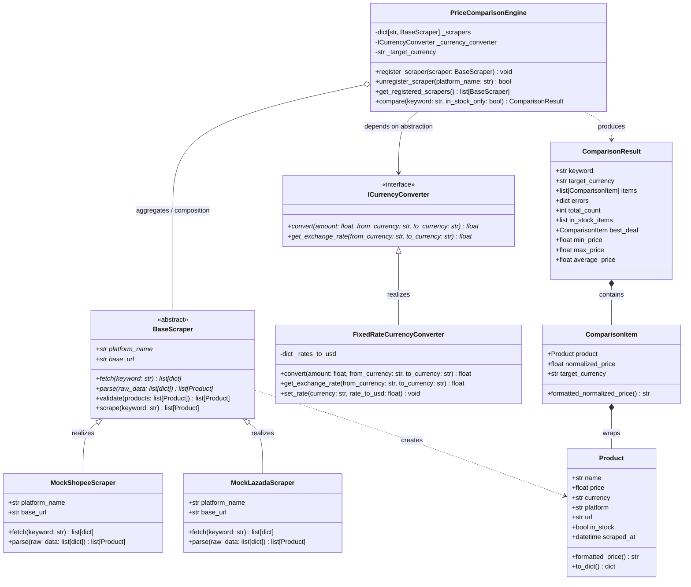
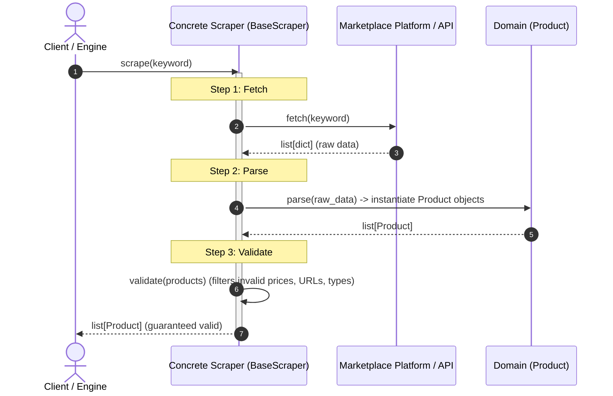

# Price Comparison Tracker

An enterprise-grade, clean Object-Oriented Analysis & Design (OOAD) implementation of a **Price Comparison Tracker** in Python. This project demonstrates foundational software engineering design patterns, strict **SOLID** principles, and a clean hexagonal/layered architecture layout.

---

## 📑 Table of Contents
- [Architecture & Design](#architecture--design)
  - [Class Diagram](#class-diagram)
  - [Template Method Lifecycle](#template-method-lifecycle)
- [SOLID Principles Adherence](#solid-principles-adherence)
- [Design Patterns](#design-patterns)
- [Directory Structure](#directory-structure)
- [Installation & Quickstart](#installation--quickstart)
- [Running Unit Tests](#running-unit-tests)
- [Extending the System (Adding New Scrapers)](#extending-the-system-adding-new-scrapers)

---

## 🏛 Architecture & Design

The system models an e-commerce aggregation platform where multiple marketplace scrapers fetch and parse disparate catalog structures, validate domain invariants, normalize international currencies, and sort products to find the best consumer deals.

### Class Diagram



---

### Template Method Lifecycle

The scraper pipeline enforces the **Template Method Pattern** via `BaseScraper.scrape(keyword)`. The algorithm's invariant workflow is locked in the base class, while platform-specific fetch and parse details are deferred to subclasses.



---

## 🎯 SOLID Principles Adherence

| Principle | Implementation Details |
|---|---|
| **Single Responsibility (SRP)** | - `Product`: Encapsulates only domain product state and domain invariant checks.<br>- `BaseScraper`: Governs the scraping workflow skeleton.<br>- `MockShopeeScraper` / `MockLazadaScraper`: Handle platform-specific raw data acquisition and schema translation.<br>- `ICurrencyConverter`: Handles exchange rates and conversions.<br>- `PriceComparisonEngine`: Orchestrates querying scrapers, normalizing, filtering, and sorting. |
| **Open/Closed (OCP)** | The engine is open for extension but closed for modification. New scrapers (e.g., `MockAmazonScraper` or TikTok Shop) can be registered via `engine.register_scraper()` without modifying `PriceComparisonEngine` or any existing scrapers. |
| **Liskov Substitution (LSP)** | Subclasses (`MockShopeeScraper`, `MockLazadaScraper`, `MockAmazonScraper`) strictly honor the `BaseScraper` contract. Any scraper can be swapped transparently into the engine without unexpected side-effects. |
| **Interface Segregation (ISP)** | Scrapers only implement `fetch()` and `parse()` (with an optional hook into `validate()`). They are not forced to depend on unrelated aggregation or conversion interfaces. |
| **Dependency Inversion (DIP)** | `PriceComparisonEngine` depends solely on abstractions: `BaseScraper` (ABC) and `ICurrencyConverter` (ABC). Concrete implementations are passed into the constructor (Dependency Injection). |

---

## 🧩 Design Patterns

1. **Template Method Pattern (`BaseScraper.scrape`)**
   Enforces a consistent 3-stage lifecycle (`fetch` $\rightarrow$ `parse` $\rightarrow$ `validate`) across all marketplaces. Platform scrapers cannot accidentally bypass validation or alter execution order.
2. **Strategy / Service Provider Pattern (`ICurrencyConverter`)**
   Enables seamless currency conversion strategies (fixed rates, mocked rates, live API rates) to be injected without coupling market comparisons to financial rates.
3. **Composition & Dependency Injection (`PriceComparisonEngine`)**
   Scrapers and converters are composed into the engine via constructor injection or dynamic registration (`register_scraper`).
4. **Fault Isolation (Robust Aggregation)**
   If a single marketplace API fails or times out, the engine isolates the error, logs it in `result.errors`, and returns successful results from all remaining platforms.

---

## 📂 Directory Structure

```text
.
├── models/
│   ├── __init__.py
│   └── product.py            # Product domain dataclass with validation
├── scrapers/
│   ├── __init__.py
│   ├── base.py               # BaseScraper ABC (Template Method Pattern)
│   ├── shopee.py             # MockShopeeScraper implementation
│   └── lazada.py             # MockLazadaScraper implementation
├── engine/
│   ├── __init__.py
│   ├── comparison.py         # PriceComparisonEngine, ComparisonItem, ComparisonResult
│   └── currency.py           # ICurrencyConverter, FixedRateCurrencyConverter
├── tests/
│   ├── __init__.py
│   ├── test_scrapers.py      # Unit tests for scraper lifecycle and parsers
├── main.py                   # Demonstration script & CLI entry point
├── index.html                # Standalone Web Dashboard (OOAD simulation in JS)
├── requirements.txt          # Python dependencies
├── .gitignore                # Git ignore patterns
└── README.md                 # Project architecture documentation
```

---

## 🚀 Installation & Quickstart

### 1. Prerequisites
- Python 3.10+ (compatible with Python 3.10, 3.11, 3.12, 3.13, 3.14+)

### 2. Setup Virtual Environment (Recommended)
```bash
# Windows (PowerShell)
python -m venv .venv
.venv\Scripts\Activate.ps1

# macOS / Linux
python3 -m venv .venv
source .venv/bin/activate
```

### 3. Install Dependencies
```bash
pip install -r requirements.txt
```

### 4. Run the Demonstration
Execute the main script to run four demonstration scenarios (Direct Comparison, Currency Normalization, Stock Filtering, and Dynamic Scraper Extension):
```bash
python main.py
```

### 5. Run with CLI Search Query
You can pass any product search query directly from your command line:
```bash
python main.py "AirPods"
python main.py "Sony"
python main.py "Keyboard"
```

### 6. Interactive Web Dashboard (`index.html`)
Open [`index.html`](file:///C:/Users/wutti/OneDrive/Desktop/opp%20%E0%B8%87%E0%B8%B2%E0%B8%99%E0%B8%84%E0%B8%B9%E0%B9%88/index.html) directly in any modern browser (or double-click the file in Windows File Explorer). It requires **zero build tools** and runs an embedded client-side JavaScript OOP engine mirroring the Python architecture.

---

## 🧪 Running Unit Tests

Run the full pytest suite with verbose output:

```bash
python -m pytest tests -v
```

### Test Coverage Highlights
- ✅ Template method lifecycle order (`fetch` $\rightarrow$ `parse` $\rightarrow$ `validate`)
- ✅ Filtering corrupt or invalid items (negative prices, missing URLs)
- ✅ Platform parsing fidelity (Shopee satang-to-THB conversions, Lazada string floats)
- ✅ Lowest-to-highest sorting across platforms
- ✅ Cross-border currency conversion (USD to THB comparison)
- ✅ Stock availability filtering (`in_stock_only=True`)
- ✅ Fault isolation (failing scrapers do not crash engine)
- ✅ Dynamic scraper registration and unregistration

---

## 🔌 Extending the System (Adding New Scrapers)

Adding a new platform (e.g., Amazon, TikTok Shop) is clean and requires **zero changes** to existing codebase classes:

```python
from typing import Any
from scrapers.base import BaseScraper
from models.product import Product

class MyCustomScraper(BaseScraper):
    @property
    def platform_name(self) -> str:
        return "TikTokShop"

    @property
    def base_url(self) -> str:
        return "https://shop.tiktok.com"

    def fetch(self, keyword: str) -> list[dict[str, Any]]:
        # Platform-specific fetch/HTTP request
        return [{"id": 1, "title": f"{keyword} Item", "price": 499.0}]

    def parse(self, raw_data: list[dict[str, Any]]) -> list[Product]:
        # Convert platform payload into domain Product entities
        return [
            Product(
                name=item["title"],
                price=item["price"],
                currency="THB",
                platform=self.platform_name,
                url=f"{self.base_url}/item/{item['id']}",
                in_stock=True,
            )
            for item in raw_data
        ]

# Register dynamically into the engine:
engine.register_scraper(MyCustomScraper())
```
